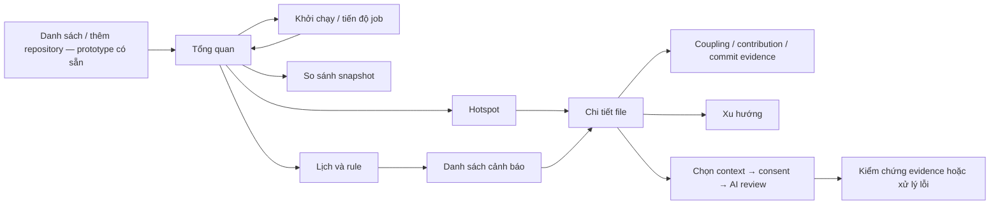

# Wireframe tuần 5

Mở [index.html](index.html) trực tiếp trong trình duyệt. Không cần server, tài khoản hay provider AI. Dữ liệu là fixture minh họa, mọi thao tác reset khi tải lại. Đây là sản phẩm thiết kế, chưa phải frontend tích hợp.

## Luồng và truy vết

Repository đã được chọn → tổng quan → hotspot → chi tiết file → xem coupling/contribution/evidence → đồng ý gửi context → AI review. Từ menu vào giám sát để chỉnh lịch/rule, xem lý do cảnh báo và đánh dấu đã xem/đóng.

| Màn hình | Nhu cầu / UC | Dữ liệu API dự kiến, tiền tố /api | Đầu ra review |
|---|---|---|---|
| Tổng quan | UC02–04, UC10 | POST repositories/{id}/analyses; GET jobs/{id}; snapshots; snapshot-comparison | Tóm tắt, job, thay đổi giữa snapshot, cảnh báo dữ liệu bị cắt |
| Hotspot | UC04 | GET snapshots/{id}/hotspots | Xếp hạng score, tie theo path, lọc; biểu đồ thanh thay treemap trong bản đầu để dễ đọc |
| Chi tiết file | UC05–07, UC11 | GET snapshot file/couplings, file trend; POST file ai-reviews | Metric, commit evidence, mẫu số coupling, contribution, lịch sử và AI có consent |
| Giám sát/cảnh báo | UC08–09 | GET/PUT monitoring; GET/POST alert-rules; GET alerts; PATCH alerts/{id} | Lịch, rule version/threshold, trạng thái và evidence |

Các route đầy đủ theo [API contract](../../api-contract.md). Việc thêm repository dùng màn hình prototype đã có, không nhận đã thiết kế lại trong bộ bốn màn hình này. Evidence phải phân trang khi tích hợp, không nạp toàn bộ commit vào trang. API đọc metric/ghi lịch/AI ở bảng trên vẫn là dự kiến.

## Quy tắc hiển thị cần giữ khi tích hợp

| Chỉ số | Hình thức được chọn | Lý do / tương tác dự kiến |
|---|---|---|
| Hotspot score | Thanh ngang + bảng xếp hạng | Dễ so thứ tự, hiện số chính xác, click vào file |
| Frequency/churn | Số trên file detail; đường theo snapshot | Phân biệt số lần sửa với lượng dòng thay đổi; tooltip ghi window |
| Complexity | Max CCN dạng số, phân bố CCN bằng histogram khi có nhiều file | Không trộn max/avg; hiển thị N/A khi không đo được |
| Contribution/HHI | Thanh chia tỷ lệ + bảng contributor và HHI dạng số | Có mẫu số churn, không dùng bảng xếp hạng năng lực |
| Coupling | Bảng cặp file + degree/shared/count A/B | Dễ kiểm chứng hơn graph dày; mở danh sách commit chung |
| Trend/compare | Đường theo thời gian + bảng before/after/delta | Chỉ so khi cấu hình tương thích, chỉ rõ window và SHA |
| Alert | Danh sách theo trạng thái + thẻ giải thích | Ưu tiên lý do, evidence, rule version và thao tác xử lý |

Wireframe hiện thể hiện đầy đủ thanh hotspot, số metric và các ví dụ before/after; histogram/đường nhiều điểm/thanh contribution là đặc tả cho bước tích hợp, chưa vẽ thành chart tương tác trong bản này.

1. Luôn hiển thị snapshot/HEAD/window/config; không trộn metric hai snapshot. Score không chứng minh có bug.
2. Không có CCN/HHI thì hiển thị chưa đủ dữ liệu và lý do; không thay bằng 0. Contribution giúp chọn người trao đổi, không xếp hạng năng lực.
3. Count coupling tính trên tập commit đủ điều kiện; ví dụ frequency toàn tập là 42, count A sau lọc coupling là 10. Đây là fixture riêng, không suy ra từ repository đang chạy.
4. AI chỉ gửi context được chọn ở snapshot sau consent; khi tích hợp phải có preview đoạn mã, giới hạn payload, lý do bị loại và evidenceId có thể mở. Wireframe mô phỏng kết quả và consent, chưa có trình chọn dòng mã hay provider thật.
5. Trạng thái tải/rỗng/lỗi có thông báo; lỗi AI không khóa dashboard. Tắt nút trùng khi job chạy và xử lý 409/429 khi tích hợp thật.
6. Form lịch đề xuất tối thiểu 60 phút; alert OPEN→ACKNOWLEDGED→CLOSED hoặc OPEN→CLOSED; không mở lại khi click Đã xem. Ngưỡng tăng 0.05 là ví dụ cần review, không chuẩn chất lượng phổ quát.

## Kịch bản nhóm trưởng có thể thử

1. Tổng quan → chạy lại → thấy QUEUED/RUNNING rồi SUCCEEDED/NO_CHANGE mô phỏng.
2. Hotspot → lọc `order`, sau đó `not-found` → hiện một file hoặc trạng thái không có kết quả.
3. Chi tiết → chưa tick consent → yêu cầu đồng ý; tick rồi chọn thành công/timeout/vượt giới hạn.
4. Cảnh báo → nhập chu kỳ 30 → form từ chối; đổi 1440 → lưu mô phỏng; Đã xem → Đóng.
5. Chọn trạng thái tải/rỗng/lỗi ở thanh trên; đổi về Có dữ liệu. Thu trình duyệt xuống 375 px để xem mobile.

Ảnh và kết quả thật: [evidence](../evidence/verification.md). Script kiểm tra: `node docs/week-05/evidence/verify-wireframes.cjs` từ repo root, sau khi frontend đã cài dependencies và browser Playwright. Ảnh desktop 1440 px và mobile 375 px cho cả bốn màn hình.
