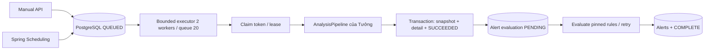

# Cài đặt lưu trữ và giám sát tuần 6

## Luồng thực thi

Migration V2 giữ V1 nguyên vẹn, thêm 9 bảng và mở rộng tracked_repository: tổng cộng 10 bảng ứng dụng, không tính Flyway history. So với thiết kế tuần 5, thêm lineage_key, trigger_type và các trường đánh giá alert trên snapshot để tránh bảng thứ 11. Summary/config/evidence là JSONB; dữ liệu nhạy cảm và raw source không thuộc hợp đồng lưu trữ này.

## Job và lịch

- Enqueue khóa repository rồi kiểm tra active job. Unique partial index là hàng rào cuối. Advisory transaction lock bảo vệ giới hạn backlog toàn DB: tối đa 20 QUEUED. Cùng repo trả 409; backlog đầy trả 429.
- Scheduler poll 10 giây, lấy tối đa 20 lịch đến hạn bằng SKIP LOCKED, bỏ qua hàng đang bị khóa. Coalesce tick bị lỡ tới kỳ tương lai, không chạy bù hàng trăm job. Busy/full hoãn 60 giây. Enqueue và advance lịch trong cùng transaction.
- Dispatcher poll 1 giây. Executor 2 worker/20 chỗ đợi. Chỉ claim sau khi task thực sự chạy, nên executor từ chối không bỏ rơi job RUNNING. Job vẫn bền trong DB khi chưa có worker.
- Claim token UUID, lease 120 giây, heartbeat 30 giây, watchdog 30 giây, deadline toàn job 15 phút. Deadline là giới hạn vận hành thử, không phải benchmark 10 phút. API ghi/worker mặc định tắt, hướng tới một instance backend giai đoạn đầu.
- Claim hết lease không thể heartbeat/publish. Watchdog chuyển FAILED/LEASE_EXPIRED. Retry thực hiện bằng yêu cầu mới; chưa có endpoint retry giữ nguyên window. Adapter phải dừng IO/process khi bị interrupt và dùng workspace theo jobId/token. Java không thể cưỡng bức dừng thư viện bỏ qua interrupt; fencing chỉ bảo vệ publication, không tự bảo vệ cache Git của adapter.
- Cấu hình adapter thay đổi khi job còn chờ: FAILED/CONFIG_CHANGED_REQUEUE_REQUIRED thay vì ghi metric dưới config hash cũ.

## Publication và lineage

AnalysisPipeline nhận Claim có URL/window/config/token. Adapter cung cấp effectiveConfig JSON ổn định, bao gồm algorithm/tool/filter/lineage versions; config hash SHA-256. Kết quả chứa head SHA thật, metric version, summary/coverageComplete, file metrics, contribution và pairs.

SnapshotPublisher kiểm tra claim còn hiệu lực, identity đầy đủ và ghi header + toàn bộ detail + SUCCEEDED trong một transaction. Đến cuối transaction kiểm tra lease lần nữa. Lỗi bất kỳ rollback tất cả detail. Identity repo/SHA/windowStart/windowEnd/configHash giống hệt → NO_CHANGE, trỏ snapshot cũ, không tạo alert mới chỉ vì quét lại.

lineageKey do ingestion cấp, scoped theo repo, ổn định qua rename. Backend không đoán rename bằng path. Cùng key phải giữ firstSeenSha/initialPath. File frequency không vượt commit count; tổng churn contributor phải bằng file churn; DB kiểm tra nonnegative/range/FK và coupling shared/min. Backend lưu số metric do adapter tính, không giả đã triển khai thuật toán JGit/Lizard.

## Cảnh báo

- Rule được chụp vào pinned_rules khi publish; chỉnh rule sau đó không đổi ý nghĩa snapshot cũ. Chỉ cài hai type tuần này: HOTSPOT_INCREASE (delta > threshold) và STRONG_COUPLING (shared >= minShared, degree >= threshold; tối thiểu 5 và 0.5).
- Evaluation chạy transaction riêng, PENDING bền sau publish; lỗi chuyển FAILED kèm code an toàn và retry sau 60 giây. API luôn trả evaluationStatus/notes, không đánh đồng chưa chạy với không có cảnh báo.
- Baseline phải có windowEnd trước snapshot mới; nếu cùng windowEnd thì theo createdAt/id trước đó, cùng config hash/version và độ dài cửa sổ. Cả hai phải không truncated và coverageComplete=true. Thiếu baseline/metric hoặc coverage không đủ ghi lý do skip, không thay null bằng 0.
- Unique gồm rule/version/snapshot/file/pair, NULLS NOT DISTINCT. Retry không nhân đôi alert và không mở lại CLOSED. OPEN→ACKNOWLEDGED→CLOSED hoặc OPEN→CLOSED; stale rule/schedule version trả 409.
- Chưa có cấu hình rule tổng quát cho mọi metric/operator, backfill lịch sử, email/push hoặc retention tự xóa dữ liệu. Các mở rộng này cần phạm vi riêng, không được ghi là đã có.

## Quyết định và nguồn

[Monitoring design của Tưởng tại 0518e52](https://github.com/Tuong2608/Git-Health-Monitor/blob/0518e52/docs/monitoring-design.md) là nguồn phối hợp; không thay thế review của Tưởng. Cài đặt giữ mô hình PostgreSQL/no Redis. Điểm khác có chủ đích: claim bên trong runnable để tránh lease hết lúc còn chờ executor; hai rule cụ thể thay engine tổng quát; raw JSONB evidence còn cần kiểm tra dung lượng khi tích hợp repo lớn.

[Spring scheduling](https://docs.spring.io/spring-framework/reference/integration/scheduling.html) được dùng cho lịch và bounded ThreadPoolTaskExecutor; [PostgreSQL SELECT/locking](https://www.postgresql.org/docs/18/sql-select.html) cho claim bằng FOR UPDATE SKIP LOCKED. Nguồn kiểm tra ngày 22/10/2026.
