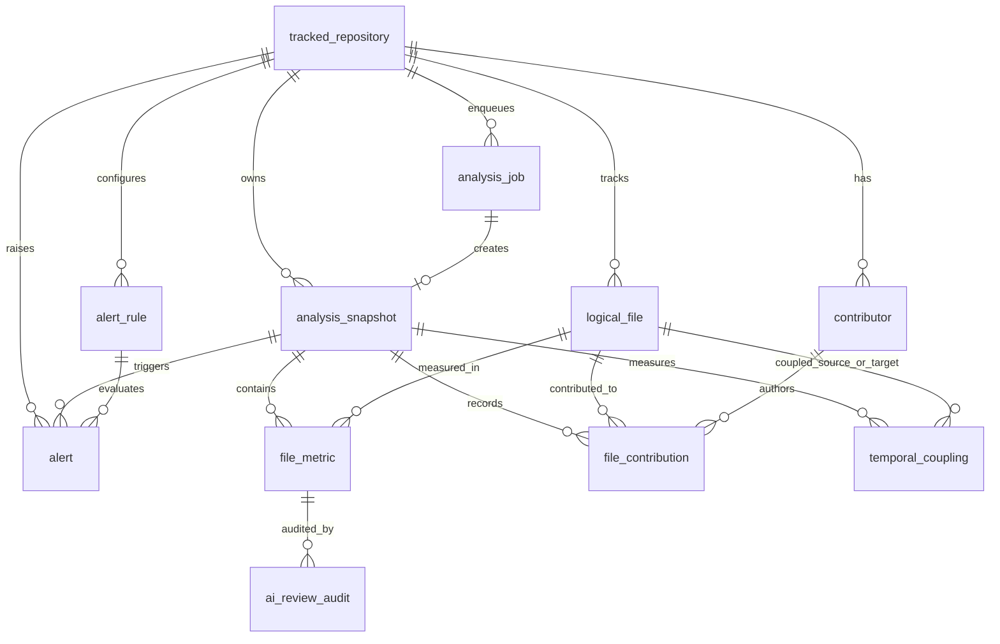

# BẢN THẢO TIỂU LUẬN CHUYÊN NGÀNH — PHẦN CỦA TRẦN QUANG TOẢN (23110158)
*(Bao gồm: Toàn bộ Chương 2, Chương 3 — Phần Hệ thống/CSDL/API/UI/Docker, Chương 4 — Phần Thực nghiệm RQ2/Benchmark PostgreSQL/Kiểm thử & JaCoCo/RQ3 & Cải tiến UI, và Phụ lục Hướng dẫn cài đặt)*

---

# CHƯƠNG 2: PHÂN TÍCH VÀ THIẾT KẾ HỆ THỐNG

## 2.1. Phân tích yêu cầu hệ thống (SRS)

### 2.1.1. Tác nhân và danh mục 11 Use Case cốt lõi (`UC01..UC11`)
Hệ thống **Git Health Monitor** phục vụ nhóm người dùng chính gồm lập trình viên (Developer), người bảo trì kho mã (Maintainer) và trưởng nhóm kỹ thuật (Technical Lead). Dựa trên kết quả khảo sát 5 người dùng thực tế (`S01..S05`) và phân tích khoảng trống công cụ ở Chương 1, hệ thống được đặc tả qua 11 ca sử dụng cốt lõi:

| Mã UC | Tên ca sử dụng | Tác nhân | Điều kiện tiên quyết (Precondition) | Tiêu chí nghiệm thu chính (Acceptance Criteria) |
|---|---|---|---|---|
| **UC01** | Đăng ký kho mã nguồn GitHub công khai | Người dùng | Cờ `APP_REGISTRATION_ENABLED=true` | Chỉ chấp nhận URL `https://github.com/<owner>/<repo>` hợp lệ; chuẩn hóa chữ thường và bỏ hậu tố `.git`; trả `201 Created` hoặc `409 Conflict` nếu trùng. |
| **UC02** | Kích hoạt phân tích bất đồng bộ | Người dùng | Kho đã đăng ký; pipeline phân tích sẵn sàng (`canAnalyze=true`) | Kiểm tra cửa sổ `1..365` ngày; tạo bản ghi `analysis_job` trạng thái `QUEUED`; trả ngay `202 Accepted` kèm `jobId` trong `< 2 giây`; từ chối `409` nếu đã có job đang chạy trên cùng kho hoặc `429` nếu hàng đợi vượt 20 job. |
| **UC03** | Theo dõi trạng thái Job và thử lại (Retry) | Người dùng / Hệ thống | Đã có `jobId` | Hiển thị tiến độ, trạng thái (`QUEUED`, `RUNNING`, `SUCCEEDED`, `FAILED`), `outcome` (`CREATED`, `NO_CHANGE`); chỉ cho phép `POST /api/jobs/{id}/retry` khi job ở trạng thái `FAILED`. |
| **UC04** | Xem tổng quan Snapshot và xếp hạng Điểm nóng (Hotspot) | Người dùng | Đã có ít nhất 1 snapshot `SUCCEEDED` | Hiển thị khoảng thời gian `[windowStart, windowEnd)`, mã `headSha` (40 ký tự hex), cờ `coverageComplete`, bản đồ nhiệt và bảng phân trang xếp giảm dần theo `hotspot_score`. |
| **UC05** | Xem chi tiết chỉ số tập tin và bằng chứng Commit | Người dùng | Tập tin thuộc snapshot đang mở | Hiển thị `change_frequency`, `churn`, `max_ccn`, `avg_ccn`, `function_count`, `nloc`, `hotspot_score`, `hhi`, `unavailable_reason` (giữ `null` tách biệt với `0`) cùng danh sách SHA commit bằng chứng trong cửa sổ. |
| **UC06** | Xem liên kết thay đổi theo thời gian (Temporal Coupling) | Người dùng | Tập tin có cặp liên kết thỏa ngưỡng | Chỉ hiển thị các cặp có `shared_commits >= 5` và `coupling_degree >= 0.50`; cho phép bấm xem danh sách SHA commit sửa chung của cặp tập tin. |
| **UC07** | Xem phân bố đóng góp và độ tập trung tri thức (HHI) | Người dùng | Tập tin có `churn > 0` | Hiển thị danh sách người đóng góp theo tổng dòng thêm/xóa và tỷ trọng đóng góp; ẩn địa chỉ email thô (`identity_key`) trên API công khai; kèm cảnh báo không đồng nhất HHI với năng lực cá nhân. |
| **UC08** | Theo dõi xu hướng lịch sử của tập tin qua nhiều Snapshot | Người dùng | Tập tin xuất hiện ở $\ge 1$ snapshot | Truy vấn chuỗi thời gian theo định danh bền vững `logical_file.id` (bảo toàn qua đổi tên `git mv`); tự động ngắt nét biểu đồ khi hai snapshot lệch `config_hash`, độ dài cửa sổ hoặc `coverageComplete = false`. |
| **UC09** | So sánh hai Snapshot (Snapshot Comparison) | Người dùng | Hai snapshot thuộc cùng kho, `from` trước `to` | Trả `409 Conflict` nếu hai snapshot khác `config_hash`, khác độ dài cửa sổ (`SNAPSHOTS_NOT_COMPARABLE_CONFIG`) hoặc có snapshot `coverageComplete = false` (`SNAPSHOTS_NOT_COMPARABLE_COVERAGE`); thực hiện `FULL OUTER JOIN` theo `file_id`, phân loại `ADDED`, `REMOVED`, `CHANGED`, `UNCHANGED`, `UNAVAILABLE`. |
| **UC10** | Cấu hình lịch quét định kỳ và quản lý Cảnh báo | Người dùng / Worker | Quyền ghi giám sát bật (`writesEnabled=true`) | Kiểm soát xung đột phiên bản lạc quan (`optimistic locking` qua cột `version`); ghim quy tắc (`pinned_rules`) tại thời điểm xuất bản snapshot; cho phép chuyển trạng thái cảnh báo `OPEN -> ACKNOWLEDGED -> CLOSED` (một chiều, không mở lại cảnh báo đã `CLOSED`). |
| **UC11** | Trợ lý rà soát mã nguồn bằng LLM có kiểm soát | Người dùng | Cờ `APP_AI_REVIEW_ENABLED=true` | Quy trình bắt buộc 2 bước: (1) `POST /ai-review-preview` trích xuất đoạn mã (`1..200` dòng, $\le 8\text{ KiB}$) tại đúng blob `headSha` của snapshot và trả về `contextHash` SHA-256; (2) `POST /ai-reviews` kiểm tra `consent=true` khớp `contextHash`, quét secret (`SECRET_DETECTED`), kiểm tra schema JSON + `evidenceAllowlist` và ghi metadata vào `ai_review_audit`. |

### 2.1.2. Hệ thống quy tắc nghiệp vụ (`BR01..BR18`) và yêu cầu phi chức năng (`NFR01..NFR08`)
Các quy tắc nghiệp vụ cốt lõi được cài đặt thành các ràng buộc cứng ở tầng dịch vụ và cơ sở dữ liệu:
- **Quy tắc bảo toàn sự thật dữ liệu (`BR01..BR06`):** Không bao giờ thay thế giá trị chưa đo được (`null`) bằng số `0`; phân biệt tập tin có `frequency = 0` (tồn tại ở `headSha` nhưng không có commit sửa trong cửa sổ) với tập tin có `frequency = null` (`LINEAGE_AMBIGUOUS` do đi qua merge commit chưa xác định duy nhất nhánh cha); không nhân bản snapshot khi quét lại cùng `(repository_id, head_sha, window_start, window_end, config_hash)` (trả kết quả `NO_CHANGE`).
- **Quy tắc an toàn cảnh báo và so sánh (`BR07..BR12`):** Mọi phép so sánh ngưỡng tăng điểm nóng ($\Delta \text{Hotspot} > \text{threshold}$) phải thực hiện bằng số học thập phân chính xác (`BigDecimal` trong Java, `NUMERIC` trong PostgreSQL, `Decimal` trong Python) để loại bỏ sai số biểu diễn nhị phân IEEE-754 tại biên ngưỡng (ví dụ `0.55 - 0.40 = 0.15`); khi `coverageComplete = false` hoặc `truncated = true`, hệ thống tự động chặn phát sinh cảnh báo `HOTSPOT_INCREASE` / `STRONG_COUPLING` và chặn API so sánh snapshot.
- **Quy tắc cô lập và bảo mật AI Review (`BR13..BR18`):** Trợ lý LLM hoàn toàn tách biệt khỏi luồng tính toán chỉ số (không dùng đầu ra LLM để sửa điểm `hotspot_score` hay gán nhãn thực nghiệm); đoạn mã gửi đi phải lấy từ Git blob tại đúng `headSha` của snapshot (không lấy từ `HEAD` mới hơn trong cache); mọi nội dung khớp mẫu khóa bí mật (`SECRET_PATTERN`) đều bị chặn với mã `403 SECRET_DETECTED` trước khi rời máy chủ; bảng `ai_review_audit` chỉ lưu siêu dữ liệu kiểm toán (`contextHash`, `promptVersion`, `provider`, `model`, `latencyMs`), tuyệt đối không lưu mã nguồn thô hay văn bản phản hồi của AI.

Tám yêu cầu phi chức năng định lượng (`NFR01..NFR08`) và kết quả đạt được thực tế:

| Mã NFR | Nội dung yêu cầu định lượng | Ngưỡng cam kết | Kết quả thực tế đạt được |
|---|---|---|---|
| **NFR01** | Thời gian phản hồi tạo Job phân tích bất đồng bộ (`POST /analyses`) | $\le 2.000\text{ ms}$ | Trả `202 Accepted` ngay sau khi ghi job, không chờ phân tích. *[CẦN ĐO bổ sung thời gian phản hồi trước khi đưa vào bản cuối]* |
| **NFR02** | Thời gian truy vấn danh sách Hotspot / Chi tiết file đã phân trang (`size <= 100`) | $\le 1.000\text{ ms}$ | Chưa đo riêng endpoint Hotspot; truy vấn so sánh 2 snapshot đo được $3,96..8,32\text{ ms}$ (benchmark PostgreSQL 18.3). *[CẦN ĐO bổ sung]* |
| **NFR03** | Tổng thời gian phân tích kho mã nguồn quy mô tối đa `10.000` commit | $\le 10\text{ phút}$ ($600\text{ s}$) | Trung bình **$48,96\text{ s}$** (CLI **$73,25\text{ s}$**, cộng lưu trữ PostgreSQL **$+0,06\text{ s}$**) |
| **NFR04** | Thời gian chờ tối đa (Timeout) cho mỗi yêu cầu gọi LLM Provider | $\le 30\text{ s}$ + đọc khối $4\text{ KiB}$ | Cài đặt `HttpLlmProviderAdapter` với deadline cứng và giới hạn payload |
| **NFR05** | Khả năng tự phục hồi Job khi tiến trình Worker dừng đột ngột | Thu hồi 100% job hết hạn lease | Cơ chế `lease_until` + `heartbeat` + `recoverExpired()` gán `LEASE_EXPIRED` |
| **NFR06** | Tính nguyên tử (Atomicity) khi công bố Snapshot | 0 snapshot dở dang khi lỗi giữa chừng | `@Transactional` trên `SnapshotPublisher.publish()` rollback toàn bộ 6 bảng |
| **NFR07** | Bảo mật đầu vào URL, chống Command Injection và chống rò rỉ Secret | 0 lỗ hổng Critical/High, 0 secret lộ | Whitelist URL GitHub, `ProcessBuilder` đối số tách biệt, Gitleaks CI xanh |
| **NFR08** | Độ phủ dòng lệnh (Line Coverage) trên các module nghiệp vụ cốt lõi | $\ge 70\%$ | Đạt **$89,07\%$ toàn hệ thống** (`repository` $100\%$, `api` $100\%$, `monitoring` $94,60\%$, `gitanalyzer` $88,12\%$, `aireview` $85,88\%$) |

---

## 2.2. Thiết kế kiến trúc tổng thể và các quyết định kiến trúc (ADR)

### 2.2.1. Kiến trúc Modular Monolith và luồng xử lý bất đồng bộ
Hệ thống được tổ chức theo kiến trúc **Modular Monolith** trên nền tảng Spring Boot 4.1.1 (Java 21), kết hợp cơ sở dữ liệu quan hệ PostgreSQL 18 và giao diện người dùng React 19 + TypeScript. Toàn bộ ứng dụng backend được phân chia thành 4 module có ranh giới giao tiếp rõ ràng qua các interface và record bất biến:
1. **Module `repository`:** Tiếp nhận, chuẩn hóa và quản lý danh mục kho mã nguồn GitHub công khai (`tracked_repository`).
2. **Module `gitanalyzer`:** Thực thi thu thập lịch sử Git qua JGit (`GitRepositoryClient`, `GitIngestion`), đo độ phức tạp hàm qua Lizard (`LizardComplexityAnalyzer`), tính toán bộ chỉ số sức khỏe (`RepositoryMetricCalculator`) và cung cấp bộ điều hợp `GitAnalysisPipeline` hiện thực hóa interface `AnalysisPipeline`.
3. **Module `monitoring`:** Quản lý vòng đời job phân tích và bộ lập lịch quét định kỳ (`MonitoringStore`, `AnalysisWorker`), xuất bản snapshot nguyên tử (`SnapshotPublisher`), đánh giá quy tắc cảnh báo (`AlertService`) và phục vụ các truy vấn đọc phân trang, xu hướng, so sánh (`SnapshotQueries`, `MonitoringController`, `SnapshotQueryController`).
4. **Module `aireview`:** Xây dựng ngữ cảnh xem trước từ blob lịch sử (`ReviewContextBuilder`), xác thực biên nhận đồng thuận SHA-256, quét secret, điều phối gọi mô hình ngôn ngữ lớn qua `LLMProviderAdapter` (`LlmReviewService`, `HttpLlmProviderAdapter`, `AiReviewController`) và ghi nhật ký kiểm toán (`ai_review_audit`).

### 2.2.2. Quyết định kiến trúc ADR-001 (JGit Full Clone) và ADR-002 (Hàng đợi PostgreSQL không dùng Redis)
Hai quyết định kiến trúc trọng tâm đã được nhóm phân tích, đánh giá phương án thay thế và ghi nhận chính thức:
- **ADR-001 — Sử dụng JGit Full Bare Clone/Fetch thay vì Partial Clone (`--filter=blob:none`):**
  - *Bối cảnh:* Việc dựng đồ thị phả hệ tập tin (`lineageKey`) có phát hiện đổi tên (`RenameDetector` với ngưỡng tương đồng nội dung $\ge 60\%$) đòi hỏi JGit phải đọc và so sánh nội dung blob của các tập tin thêm/xóa tại từng commit trong chuỗi lịch sử, đồng thời `LizardComplexityAnalyzer` và `ReviewContextBuilder` cần truy xuất trực tiếp blob Java tại các commit quá khứ.
  - *Quyết định:* Sử dụng `JGit` clone kho mã ở chế độ bare repository đầy đủ trong lần đầu tiên vào thư mục cache bền vững (`gitcache`) và chỉ chạy `git fetch` cho các lần phân tích tiếp theo; kiểm soát tài nguyên bằng giới hạn cứng `maxCommits = 10.000`, `maxTreeEntries = 100.000`, `maxBlobBytes = 2 MiB` và `maxFacts = 500.000`.
- **ADR-002 — Sử dụng bảng `analysis_job` trong PostgreSQL kết hợp `TaskExecutor` có giới hạn thay vì Redis/Redisson:**
  - *Bối cảnh:* Thiết kế ban đầu dự kiến dùng Redis làm hàng đợi job. Tuy nhiên, với quy mô triển khai single-instance staging và yêu cầu đảm bảo tính nhất quán giao dịch giữa trạng thái job và dữ liệu snapshot, việc vận hành thêm một hệ lưu trữ in-memory thứ hai làm tăng chi phí hạ tầng và nguy cơ lệch trạng thái khi một trong hai dịch vụ khởi động lại.
  - *Quyết định:* Lưu trữ toàn bộ trạng thái hàng đợi ngay trong bảng `analysis_job` của PostgreSQL 18, sử dụng khóa hàng `SELECT ... FOR UPDATE SKIP LOCKED` để nhận job an toàn dưới truy cập đồng thời, kết hợp cơ chế thuê bao có thời hạn (`lease_until`, `claim_token`, `heartbeat`) và chuyển trạng thái `analysis_job -> SUCCEEDED` trong cùng một giao dịch ACID với lệnh ghi `analysis_snapshot`. Kết quả benchmark ở Chương 4 chứng minh toàn bộ chu trình giao dịch PostgreSQL ở quy mô 10.000 commit chỉ tốn **59,90 ms**, hoàn toàn không tạo nút thắt cổ chai.

---

## 2.3. Thiết kế Cơ sở dữ liệu (11 bảng qua 4 phiên bản Flyway `V1..V4`)

Lược đồ cơ sở dữ liệu được quản lý tự động bằng công cụ **Flyway** qua 4 tập tin migration (`V1` đến `V4`), bao gồm 10 bảng nghiệp vụ cốt lõi theo đề cương và 1 bảng kiểm toán AI (`ai_review_audit`) được bổ sung ở `V4`:



Bảng đặc tả chi tiết 11 bảng dữ liệu và các ràng buộc toàn vẹn chính:

| STT | Tên bảng (Flyway) | Khóa chính & Khóa ngoại chính | Ràng buộc toàn vẹn & Chỉ mục (Index) quan trọng | Vai trò trong hệ thống |
|---:|---|---|---|---|
| **1** | `tracked_repository` (`V1`, mở rộng ở `V2`) | `id` (IDENTITY PK) | `UNIQUE(url)`; `CHECK (interval_minutes >= 60)` (ứng dụng giới hạn `60..43200` phút); `CHECK (monitoring_version > 0)` chống ghi đè cấu hình lịch. | Lưu thông tin kho GitHub (`url`, `owner`, `name`), trạng thái bật/tắt quét định kỳ và thời điểm quét kế tiếp (`next_scan_at`). |
| **2** | `analysis_job` (`V2`) | `id` (IDENTITY PK), `repository_id FK`, `retry_of_job_id FK`, `result_snapshot_id FK` | Partial Unique Index `one_active_job ON analysis_job(repository_id) WHERE status IN ('QUEUED','RUNNING')`; chỉ mục `job_queue`, `job_lease`; `CHECK` trạng thái và tiến độ `0..100`. | Hàng đợi job bền vững: lưu `claim_token`, `lease_until`, `attempt_count`, cửa sổ `[window_start, window_end)`, `config_hash` và mã lỗi. |
| **3** | `analysis_snapshot` (`V2`) | `id` (IDENTITY PK), `repository_id FK`, `created_by_job_id FK` | Khóa tự nhiên `(repository_id, head_sha, window_start, window_end, config_hash)` dùng để phát hiện `NO_CHANGE`; chỉ mục `snapshot_latest(repository_id, created_at DESC, id DESC)`. | Lưu bản chụp bất biến của kho mã tại `head_sha`, kèm JSON `summary` (`coverageComplete`, `hotspotPopulation`...), `pinned_rules` và `evaluation_status`. |
| **4** | `logical_file` (`V2`) | `id` (IDENTITY PK), `repository_id FK` | `UNIQUE(repository_id, lineage_key)` với `lineage_key = "<firstSeenSha>:<initialPath>"`. | Định danh bền vững của tập tin xuyên suốt lịch sử đổi tên (`git mv`), tách biệt với đường dẫn tạm thời tại từng snapshot. |
| **5** | `file_metric` (`V2`, mở rộng nullable ở `V3`) | `snapshot_id FK`, `file_id FK` | `CHECK (hotspot_score IS NULL OR hotspot_score BETWEEN 0 AND 1)`; ràng buộc `V3`: `metric_missing_requires_reason`, `hotspot_requires_inputs`, `hhi_requires_churn`; chỉ mục `hotspot_rank(snapshot_id, hotspot_score DESC NULLS LAST, path_at_snapshot)` và `metric_trend(file_id, snapshot_id)`. | Lưu toàn bộ chỉ số cấp tập tin tại một snapshot (`change_frequency`, `churn`, `max_ccn`, `avg_ccn`, `function_count`, `nloc`, `hotspot_score`, `hhi`, `evidence` JSONB). |
| **6** | `contributor` (`V2`) | `id` (IDENTITY PK), `repository_id FK` | `UNIQUE(repository_id, identity_key)`. | Lưu danh tính chuẩn hóa của người đóng góp (`identity_key`, `display_name`, `aliases`). |
| **7** | `file_contribution` (`V2`) | `PRIMARY KEY (snapshot_id, file_id, contributor_id)` | `CHECK (additions >= 0 AND deletions >= 0 AND commit_count >= 0)`; tổng `additions + deletions` của các tác giả được `SnapshotPublisher` kiểm tra phải bằng `churn` của file. | Lưu số dòng thêm, dòng xóa và số commit của từng tác giả trên từng tập tin trong snapshot để tính HHI. |
| **8** | `temporal_coupling` (`V2`) | `PRIMARY KEY (snapshot_id, source_file_id, target_file_id)` | `CHECK (source_file_id < target_file_id)` chống lưu trùng cặp $(A,B)$ và $(B,A)$; cột sinh tự động `coupling_degree GENERATED ALWAYS AS (shared_commits::numeric / LEAST(commit_count_a, commit_count_b)) STORED`. | Lưu các cặp tập tin thường thay đổi cùng nhau và danh sách SHA commit sửa chung (`evidence` JSONB). |
| **9** | `alert_rule` (`V2`) | `id` (IDENTITY PK), `repository_id FK` | `CHECK (type IN ('HOTSPOT_INCREASE', 'STRONG_COUPLING'))`; cột `version` kiểm soát cập nhật quy tắc. | Lưu cấu hình ngưỡng cảnh báo của từng repository (`parameters` JSONB chứa `threshold`, `minShared`). |
| **10** | `alert` (`V2`) | `id` (IDENTITY PK), `repository_id FK`, `snapshot_id FK`, `baseline_snapshot_id FK` | Chỉ mục `alert_inbox(repository_id, status, created_at DESC)`; lệnh chèn dùng `ON CONFLICT DO NOTHING` để đánh giá lại không sinh cảnh báo trùng; `CHECK (status IN ('OPEN','ACKNOWLEDGED','CLOSED'))`. | Lưu các cảnh báo phát sinh cùng `observed_value`, `threshold`, `rule_version` đã ghim và lịch sử chuyển trạng thái (`acknowledged_at`, `closed_at`). |
| **11** | `ai_review_audit` (`V4`) | `id` (IDENTITY PK), `review_id`, khóa ngoại tới tập tin trong snapshot | Cột `metadata` JSONB lưu `contextHash`, phiên bản prompt/schema, provider, model, trạng thái, độ trễ (xem `V4__ai_review_audit.sql`). | Lưu vết kiểm toán mỗi lần gọi AI Review (`context_hash`, `prompt_version`, `schema_version`, `provider`, `model`, `status`, `latency_ms`) mà không lưu mã nguồn. |

---

# CHƯƠNG 3: CÀI ĐẶT HỆ THỐNG (PHẦN CƠ SỞ DỮ LIỆU, HÀNG ĐỢI JOB, TẦNG API, GIAO DIỆN VÀ CI/CD)

## 3.1. Cài đặt cơ chế Hàng đợi Job bền vững, Xuất bản Snapshot và Đánh giá Cảnh báo

### 3.1.1. Điều phối Job bất đồng bộ trên PostgreSQL (`MonitoringStore` & `AnalysisWorker`)
Để vận hành hàng đợi công việc không cần Redis (`ADR-002`), lớp `MonitoringStore` và `AnalysisWorker` phối hợp qua 4 cơ chế kỹ thuật:
1. **Chống tràn hàng đợi và chống trùng Job (`enqueue`):** Trước khi thêm job mới, `MonitoringStore.enqueue()` lấy khóa giao dịch `pg_advisory_xact_lock` để tuần tự hóa các yêu cầu, kiểm tra tổng số job `QUEUED` trên toàn hệ thống chưa đạt 20 (trả `429` nếu đầy). Nhờ chỉ mục duy nhất có điều kiện `one_active_job`, mọi yêu cầu gửi đồng thời vào cùng một repository đều được PostgreSQL tuần tự hóa: chỉ 1 yêu cầu tạo được job (`202 Accepted`), yêu cầu còn lại nhận mã `409`.
2. **Nhận việc không khóa chéo (`claim` với `FOR UPDATE SKIP LOCKED`):** Định kỳ mỗi 1 giây (`@Scheduled(fixedDelay=1000)`), `AnalysisWorker.dispatch()` gọi `runOne()`, trong đó `store.claim()` nhận job. Câu lệnh SQL chọn đúng 1 job `QUEUED` cũ nhất (`ORDER BY requested_at, id LIMIT 1 FOR UPDATE SKIP LOCKED`), chuyển sang `RUNNING`, cấp một mã `claim_token` (UUID ngẫu nhiên) và đặt hạn thuê `lease_until = clock_timestamp() + interval '120 seconds'`.
3. **Gia hạn thuê bao (`heartbeat`) và thu hồi Job treo (`recoverExpired`):** Trong suốt thời gian `GitAnalysisPipeline` đang chạy JGit và Lizard, một luồng nền (`ScheduledExecutorService`) gửi `heartbeat` định kỳ để gia hạn `lease_until`; nếu `heartbeat` thất bại thì luồng phân tích bị ngắt (`Lease lost`). Nếu tiến trình backend bị dừng đột ngột, hàm `recoverExpired()` (chạy mỗi 30 giây qua `AnalysisWorker.recover()`) sẽ phát hiện các job `RUNNING` có `lease_until <= clock_timestamp()` và chuyển sang `FAILED` với mã lỗi `LEASE_EXPIRED`, cho phép người dùng bấm `Retry` an toàn.
4. **Gộp lịch quét định kỳ (`scheduleDue`):** Với các repository bật `monitoring_enabled = true`, hàm `scheduleDue()` tính mốc `next_scan_at` tiếp theo bằng phép chia nguyên khoảng thời gian đã trôi qua cho `scan_interval_minutes`. Nhờ đó, nếu hệ thống tạm dừng nhiều ngày rồi bật lại, bộ lập lịch sẽ **gộp (coalesce)** các nhịp quét bị lỡ thành đúng 1 job duy nhất thay vì gây bão hàng đợi.

### 3.1.2. Xuất bản Snapshot nguyên tử (`SnapshotPublisher`)
Lớp `SnapshotPublisher.publish(Claim c, SnapshotData data)` được đánh dấu `@Transactional` để đảm bảo toàn bộ quá trình lưu kết quả diễn ra nguyên tử:
- **Xác thực quyền sở hữu lease:** Kiểm tra job vẫn đang ở trạng thái `RUNNING`, khớp `claim_token` và `lease_until > clock_timestamp() FOR UPDATE`. Nếu lease đã hết hạn hoặc bị thu hồi, ném ngay `409 CLAIM_EXPIRED` và hủy bỏ giao dịch.
- **Kiểm tra bất biến dữ liệu trước khi ghi:** Xác minh định dạng `headSha` (40 hoặc 64 ký tự hex), kiểm tra mọi tập tin có `frequency == null` hoặc `maxCcn == null` đều phải có `unavailableReason` tương ứng và không được có `hotspot_score`, đồng thời tổng `additions + deletions` của danh sách `contributions` phải bằng đúng `churn` của tập tin. Nếu bất kỳ tập tin hay cặp coupling nào vi phạm, toàn bộ transaction tự động rollback (không để lại bản ghi mồ côi trong `analysis_snapshot` hay `logical_file`).
- **Ghim quy tắc cảnh báo (`pinned_rules`):** Tại thời điểm tạo snapshot, hệ thống chụp lại mảng JSON cấu hình của toàn bộ `alert_rule` đang bật (`enabled = true`) vào cột `analysis_snapshot.pinned_rules` và đặt `evaluation_status = 'PENDING'`.

### 3.1.3. Đánh giá Cảnh báo tách biệt giao dịch (`AlertService`)
Việc đánh giá cảnh báo được thực hiện qua `AlertService.evaluateNext()` trong một giao dịch **tách biệt** sau khi `SnapshotPublisher.publish()` đã commit:
- Nhờ tách riêng hai giao dịch, nếu quá trình đánh giá cảnh báo gặp sự cố, snapshot đã phân tích xong vẫn được bảo toàn nguyên vẹn trong cơ sở dữ liệu với trạng thái `evaluation_status = 'FAILED'` để tự động thử lại sau 60 giây.
- Đối với quy tắc `HOTSPOT_INCREASE`, `AlertService` tìm snapshot chuẩn liền trước (`baseline`) của cùng repository có cùng `config_hash`, `config_version` và cùng độ dài cửa sổ `window_end - window_start`. Nếu snapshot hiện tại hoặc snapshot chuẩn có `truncated = true` hoặc `summary.coverageComplete = false`, hệ thống **không phát sinh cảnh báo** mà ghi chú `INCOMPLETE_COVERAGE` vào `evaluation_notes`. Ngược lại, khi cả hai snapshot đều đầy đủ độ phủ, câu truy vấn SQL nối hai bảng `file_metric` qua khóa bền vững `file_id` (`logical_file.id`) và so sánh chính xác trên kiểu `NUMERIC`: `n.hotspot_score - o.hotspot_score > threshold`.

---

## 3.2. Cài đặt Tầng REST API và Kiểm soát Trợ lý AI Review

Tầng giao tiếp HTTP được chia thành 4 bộ điều khiển (`Controller`) cùng bộ xử lý ngoại lệ tập trung `ApiExceptionHandler` (chuẩn hóa lỗi về cấu trúc JSON mà không bao giờ làm lộ stack trace hay đường dẫn hệ thống tập tin nội bộ):
1. **`RepositoryController` (`/api/repositories`):** Cung cấp API đăng ký, liệt kê và xem chi tiết kho mã nguồn.
2. **`MonitoringController` (`/api/repositories/{repo}/analyses`, `/jobs`, `/monitoring`, `/alert-rules`, `/alerts`):** Quản lý kích hoạt phân tích, thử lại job lỗi, cấu hình lịch quét định kỳ (kiểm tra `version` trả `409 MONITORING_VERSION_CONFLICT` nếu xung đột), thêm/bật/tắt quy tắc cảnh báo (`409 RULE_VERSION_CONFLICT`) và chuyển trạng thái cảnh báo (`409 ALERT_ALREADY_CLOSED` nếu cố mở lại cảnh báo đã đóng).
3. **`SnapshotQueryController` (`/api/snapshots/{id}`, `/hotspots`, `/files/{file}`, `/contributions`, `/evidence`, `/couplings`, `/trend`, `/snapshot-comparison`):** Cung cấp toàn bộ truy vấn chỉ đọc (`@Transactional(readOnly = true)`). Mọi tài nguyên tập tin đều được định danh bằng khóa số nguyên `file_id` thay vì truyền đường dẫn chuỗi trên URL để tránh lỗi ký tự đặc biệt và bảo toàn truy vết khi tập tin đổi tên.
4. **`AiReviewController` và `ReviewContextBuilder` (`/api/snapshots/{snapshot}/files/{file}/ai-review-preview` và `/ai-reviews`):**
   - `ReviewContextBuilder` truy vấn `head_sha` của `snapshot` và `path_at_snapshot` của `file_id` từ PostgreSQL, sau đó dùng JGit đọc trực tiếp blob mã nguồn tại đúng commit `head_sha` trong thư mục cache (`repo-{repositoryId}.git`). Nhờ đó, ngay cả khi kho Git đã fetch thêm các commit mới hơn sau khi chụp snapshot, đoạn mã gửi đi rà soát vẫn khớp tuyệt đối với phiên bản mã nguồn của snapshot đó.
   - Hệ thống trích xuất đúng đoạn dòng `[startLine, endLine]` (kiểm tra `1 <= startLine <= endLine` và `endLine - startLine < 200`), gom tối đa 5 commit bằng chứng (`E1..E5`) và 5 cặp coupling (`E6..`), tạo chuỗi JSON chuẩn hóa và băm SHA-256 thành `contextHash`.
   - Khi người dùng gọi `POST /ai-reviews`, `AiReviewController` tạo biên nhận `ConsentReceipt` gắn với `contextHash` vừa xem, kiểm tra giới hạn đồng thời/tốc độ (trả `429 RATE_LIMITED`) và deadline tối đa 35 giây (trả `504 DEADLINE_EXCEEDED`) và chuyển cho `LlmReviewService` kiểm tra secret, gọi `HttpLlmProviderAdapter`, xác thực schema phản hồi và lưu vết vào bảng `ai_review_audit`.

---

## 3.3. Cài đặt Giao diện Người dùng (React 19 + TypeScript) và Pipeline CI/CD

### 3.3.1. Kiến trúc giao diện `AnalysisDashboard.tsx` và cơ chế chống dữ liệu cũ (`Stale Response Guard`)
Ứng dụng frontend được xây dựng bằng **React 19**, **TypeScript**, **Vite 8** và thư viện biểu đồ **Recharts**:
- **Kiểm soát bất đồng bộ an toàn (`useRemote` với `AbortController`):** Khi người dùng chuyển đổi nhanh giữa các repository, snapshot hoặc tập tin, hook `useRemote(path, refresh, poll)` tự động gọi `controller.abort()` để hủy yêu cầu HTTP trước đó và kiểm tra khóa khớp `state.path === path && state.refresh === refresh`. Cơ chế này ngăn chặn triệt để lỗi điều kiện tranh chấp (race condition) khi một phản hồi mạng chậm của snapshot cũ trả về sau và ghi đè lên màn hình của snapshot mới.
- **Vẽ biểu đồ xu hướng phân đoạn (`Trend`):** Khi hiển thị lịch sử `hotspot_score` của một tập tin qua nhiều snapshot, component `Trend` kiểm tra tính tương thích giữa từng cặp điểm liền kề (`configHash`, `configVersion`, độ dài cửa sổ `windowEnd - windowStart`, `truncated == false` và `coverageComplete == true`). Nếu phát hiện bất kỳ sự thay đổi cấu hình hoặc thiếu độ phủ nào, hệ thống tự động tách sang một chuỗi dữ liệu mới (`series0`, `series1`...) với `connectNulls={false}` để **ngắt nét đường biểu đồ**, không bao giờ vẽ đường nối gây hiểu nhầm qua hai mốc không tương thích.

### 3.3.2. Đóng gói Docker đa tầng và Pipeline GitHub Actions CI 5 chặng
- **Đóng gói Container (`backend/Dockerfile`, `frontend/Dockerfile`, `compose.yaml`, `compose.staging.yaml`):**
  - Container `backend` dùng multi-stage build: `maven:3.9-eclipse-temurin-21` để build và `eclipse-temurin:21-jre` để chạy, cài `lizard==1.24.3` trong virtualenv Python `/opt/lizard`.
  - Container `frontend` biên dịch gói tài nguyên tĩnh qua `node:24-alpine` và phục vụ bằng `nginx:stable-alpine`, chuyển tiếp nội bộ `/api/*` tới `http://backend:8080/api/`.
  - Bản chồng `compose.staging.yaml` bổ sung `caddy:2.9-alpine` tự động hóa chứng chỉ HTTPS ở cổng `80/443`.
- **Pipeline GitHub Actions CI (`.github/workflows/ci.yaml`):** Tự động kích hoạt trên mọi lượt `push` và `pull_request` với 5 job kiểm chứng độc lập:
  1. `experiments`: Chạy bộ 37 ca unit test Python kiểm tra các công cụ thực nghiệm RQ1, RQ2, Benchmark và RQ3 SUS.
  2. `backend`: Khởi tạo dịch vụ `postgres:18` thật, cài đặt `lizard==1.24.3` và chạy `./mvnw -B -ntp verify` (thực thi Flyway `V1..V4`, 122 ca JUnit test và sinh báo cáo độ phủ JaCoCo `0.8.12`).
  3. `frontend`: Chạy `npm ci`, `npm run lint`, `npm run build`, `npm audit --audit-level=high` và bộ kiểm thử trình duyệt Playwright Chromium.
  4. `secret-scan`: Quét toàn bộ lịch sử commit bằng `gitleaks:v8.24.2` đảm bảo `0` khóa bí mật bị rò rỉ.
  5. `package`: Chỉ chạy khi cả 4 job trên đều xanh; dựng image Docker của cả backend và frontend, khởi chạy cụm `docker compose up -d --build` và kiểm tra smoke test trực tiếp qua `/api/health` và `/api/analysis-capabilities` (`canAnalyze == true`).

---

# CHƯƠNG 4: THỰC NGHIỆM VÀ ĐÁNH GIÁ HỆ THỐNG (PHẦN RQ2, BENCHMARK POSTGRESQL, KIỂM THỬ & ĐỘ PHỦ JACOCO, VÀ THỰC NGHIỆM NGƯỜI DÙNG RQ3)

## 4.1. Thực nghiệm RQ2: Theo dõi xu hướng và giải thích biến động qua nhiều Snapshot (`STT 31`)

### 4.1.1. Thiết kế thực nghiệm và chống rò rỉ thời gian (`HistoricalSnapshotExport`)
Câu hỏi nghiên cứu **RQ2** đặt ra: *"Việc lưu trữ nhiều snapshot có cho phép phát hiện và giải thích những thay đổi đáng chú ý về rủi ro bảo trì của codebase theo thời gian hay không?"*
Để tránh lỗi rò rỉ dữ liệu từ tương lai (đo độ phức tạp trên mã nguồn `HEAD` hiện tại rồi ghép với lịch sử commit quá khứ), nhóm đã xây dựng công cụ dòng lệnh `HistoricalSnapshotExport.java` gọi trực tiếp `GitIngestion`, `LizardComplexityAnalyzer` và `RepositoryMetricCalculator` tại đúng mã commit lịch sử `headSha`. Trước khi trích xuất, hàm `validateHistoricalHead` duyệt toàn bộ cây tổ tiên reachable từ `headSha` và từ chối ngay (`FUTURE_COMMIT_IN_HISTORICAL_TREE`) nếu có bất kỳ commit tổ tiên nào có `committerTime >= windowEnd`.

Thực nghiệm RQ2 được tiến hành trên hai tầng dữ liệu bổ trợ cho nhau:
1. **Bộ 5 kịch bản tiến hóa mã nguồn có kiểm soát (`S1..S5` — `evaluate_rq2_scenarios.py`):** Khởi tạo 5 kho Git thực tế và chạy trực tiếp qua pipeline Java/JGit/Lizard để kiểm chứng khả năng phát hiện đúng biến động, bảo toàn phả hệ qua đổi tên và chặn báo động giả.
2. **Bộ 9 snapshot lịch sử trên 3 dự án Java mã nguồn mở thực tế (`gs-rest-service`, `spring-petclinic`, `commons-cli`):** Đóng băng mã SHA tại 3 mốc cắt thời gian UTC (`2024-01-01`, `2025-01-01`, `2026-01-01`, cửa sổ 180 ngày `[start, end)`) trong manifest `docs/week-09/evidence/frozen-manifest.json` trước khi chạy và kiểm chứng tính tái lập khớp 100% mã băm SHA-256 trên cả `15/15` tập tin kết quả (`9` snapshot + `6` comparison).

### 4.1.2. Kết quả trên 5 kịch bản tiến hóa có kiểm soát (`S1..S5`) và đồng nhất với PostgreSQL
Cả **5/5 kịch bản (`S1..S5`)** đều vượt qua toàn bộ điều kiện kiểm toán tự động:

| Mã kịch bản | Tình huống tiến hóa mã nguồn được mô phỏng | Trạng thái so sánh | Tập tin kiểm tra | Biến động `hotspot_score` (Trước $\to$ Sau, $\Delta$) | Kết quả phát hiện & Giải thích bằng chứng |
|---|---|---|---|---|---|
| **S1** | Tần suất sửa và độ phức tạp (`max_ccn`) cùng tăng trên `A.java` | `COMPARABLE` | `A.java` | $0,0000 \to 1,0000$ ($+1,0000$) | Phát hiện đúng `1` ứng viên cảnh báo (`> +0.15`); `evidenceCommits` truy vết chính xác `3/3` SHA commit trong cửa sổ sau. |
| **S2** | Đổi tên `src/LegacyService.java` $\to$ `src/RenamedService.java` (`git mv`) rồi tăng nhánh điều kiện | `COMPARABLE` | `RenamedService.java` | $0,0000 \to 1,0000$ ($+1,0000$) | Giữ nguyên `lineageKey` qua đổi tên; `added = 0, removed = 0`; phát hiện đúng `1` ứng viên cảnh báo trên tập tin đã đổi tên. |
| **S3** | Trượt cửa sổ 180 ngày làm 3 commit cũ rời khỏi cửa sổ trong khi mã nguồn và `max_ccn = 5` không đổi | `COMPARABLE` | `StableComplex.java` | $0,8660 \to 0,5000$ ($-0,3660$) | `frequency: 3 -> 0`, `maxCcn: 5 -> 5`, `evidenceCommits = []`, `alertCandidates = 0`. Hệ thống chỉ rõ điểm giảm là do trượt cửa sổ thời gian chứ không kết luận nhầm là mã nguồn đã được tái cấu trúc. |
| **S4** | Kiểm chứng chính xác biên ngưỡng `+0.15` bằng số học `Decimal` / `BigDecimal` trên kho 21 tập tin | `COMPARABLE` | `F08.java` | Bước 1: $0,40 \to 0,55$ ($+0,1500$)<br>Bước 2: $0,55 \to 0,775$ ($+0,2250$) | Tại Bước 1 (`+0.15`), phép trừ `float` nhị phân IEEE-754 bị lệch thành `0.15000000000000002`, nhưng phép so sánh `Decimal` (Python) và `NUMERIC` (PostgreSQL) đều chặn đúng (`0` cảnh báo); sang Bước 2 (`+0.225 > 0.15`) mới phát đúng `1` cảnh báo. |
| **S5** | Nhánh merge gây `LINEAGE_AMBIGUOUS` hoặc so sánh hai snapshot khác độ dài cửa sổ (90 ngày vs 180 ngày) | `BLOCKED` | `Main.java` / `A.java` | Cảnh báo chính thức = `null` | Hệ thống tự động chặn phát cảnh báo (`INCOMPLETE_COVERAGE` / `WINDOW_DURATION_CHANGED`) và giữ số liệu ở chế độ chẩn đoán (`diagnosticChangesOnly = true`); trên PostgreSQL trả mã `409 CONFLICT`. |

### 4.1.3. Kết quả kiểm toán 9 Snapshot OSS và phân rã `369` thực thể tập tin (`NO_FUNCTIONS` vs `LINEAGE_AMBIGUOUS`)
Trên 3 dự án OSS thực tế (`gs-rest-service`, `spring-petclinic`, `commons-cli`), cả `9/9` snapshot đều hoàn tất trích xuất. Khi đối chiếu 6 cặp snapshot liền kề theo năm (`2024 -> 2025` và `2025 -> 2026`), hệ thống ghi nhận hai kết quả định lượng quan trọng:
1. **Truy vết bằng chứng commit đạt 100% (`91/91` cặp tập tin chung):** Trên toàn bộ `91` cặp tập tin chung có điểm chẩn đoán giữa các năm (`4 + 4` ở `gs-rest-service`, `20 + 21` ở `spring-petclinic`, `6 + 36` ở `commons-cli`), hàm kiểm toán `verify_comparison_traceability` xác nhận **91/91 tập tin (100%)** có danh sách `evidenceCommits` khớp tuyệt đối với tập `facts` trong cửa sổ `[windowStart, windowEnd)`. Ví dụ tại cặp `gs-rest-service` (`2025 -> 2026`), tập tin `GreetingControllerTests.java` có `frequency` tăng từ $0 \to 2$, `max_ccn` giữ nguyên $1$, kéo `hotspot_score` từ $0,5000 \to 0,7071$ ($\Delta = +0,2071$) với 2 commit bằng chứng cụ thể (`389429a7` và `ccccdcd7`).
2. **Phân rã định lượng nguyên nhân chặn `INCOMPLETE_COVERAGE` trên `369` thực thể tập tin Java (`audit_rq2_coverage.py`):**
   Để làm rõ vì sao cả `6/6` cặp OSS thực tế đều kích hoạt chốt chặn an toàn `BLOCKED` (`coverageComplete = false`), công cụ `audit_rq2_coverage.py` đã phân tích toàn bộ **369 lượt tập tin Java** trong 9 snapshot OSS:

| Dự án & Mốc Snapshot | Tổng file Java (`currentJavaFiles`) | Quần thể có điểm Hotspot (`COMPLETE`) | `NO_FUNCTIONS` (phả hệ rõ, `functions = 0`) | `LINEAGE_AMBIGUOUS` (có `maxCcn` hợp lệ) | `LINEAGE_AMBIGUOUS` kiêm `NO_FUNCTIONS` | Quần thể Hotspot nếu phân giải merge ở `v2` |
|---|---:|---:|---:|---:|---:|---:|
| `gs-rest-service` (2024 / 2025 / 2026) | $6 \times 3 = 18$ | $4 \times 3 = 12$ ($66,67\%$) | $0$ | $1 \times 3 = 3$ | $1 \times 3 = 3$ (`Greeting.java`) | $15 / 18$ ($83,33\%$) |
| `spring-petclinic-0` (2024-01-01) | $40$ | $20$ ($50,00\%$) | $10$ | $9$ | $1$ | $29 / 40$ ($72,50\%$) |
| `spring-petclinic-1` (2025-01-01) | $40$ | $21$ ($52,50\%$) | $10$ | $7$ | $2$ | $28 / 40$ ($70,00\%$) |
| `spring-petclinic-2` (2026-01-01) | $47$ | $22$ ($46,81\%$) | $12$ | $7$ | $6$ | $29 / 47$ ($61,70\%$) |
| `commons-cli-0` (2024-01-01) | $52$ | $6$ ($11,54\%$) | $1$ (`package-info.java`) | $44$ | $1$ | $50 / 52$ ($96,15\%$) |
| `commons-cli-1` (2025-01-01) | $85$ | $36$ ($42,35\%$) | $2$ (`package-info.java`) | $45$ | $2$ | $81 / 85$ ($95,29\%$) |
| `commons-cli-2` (2026-01-01) | $87$ | $38$ ($43,68\%$) | $2$ (`package-info.java`) | $45$ | $2$ | $83 / 87$ ($95,40\%$) |
| **Tổng cộng 9 Snapshot OSS** | **369** | **155 (42,01%)** | **37 (10,03%)** | **160 (43,36%)** | **17 (4,61%)** | **315 / 369 (85,37%)** |

   Kết quả phân rã chỉ ra rành mạch hai cơ chế kỹ thuật:
   - **Nhóm `NO_FUNCTIONS` có phả hệ rõ (`37 / 369` thực thể, chiếm $10,03\%$):** Gồm các `interface` Spring Data Repository (`PetTypeRepository.java`), lớp thực thể chỉ khai báo thuộc tính hoặc `package-info.java` không chứa phương thức nên Lizard trả về `functions = 0` và `maxCcn = null`. Trong `RepositoryMetricCalculator.java` (dòng 227–230), các tập tin này vẫn có `frequency != null` và `functions != null`, nên **không** làm `coverageComplete = false`; chúng chỉ được loại khỏi mẫu số tính phân vị `hotspotPopulation`.
   - **Nhóm `LINEAGE_AMBIGUOUS` (`177 / 369` thực thể, chiếm $47,97\%$):** Do quy tắc phả hệ `v1` trong `GitIngestion.java` (dòng 103–110) ưu tiên tính an toàn, mọi merge commit mà tập tin chỉ xuất hiện hoặc có định danh khác nhau ở các nhánh cha đều được đánh dấu `LINEAGE_AMBIGUOUS` (`frequency = null`). Chính nhóm này làm `coverageComplete = false` và kích hoạt trạng thái `BLOCKED`. Nếu quy tắc nối phả hệ qua merge commit được mở rộng ở phiên bản `v2`, tỷ lệ tập tin thuộc quần thể Hotspot trên 9 snapshot sẽ tăng hơn gấp đôi từ **42,01% (`155/369`)** lên **85,37% (`315/369`)**.

---

## 4.2. Thực nghiệm Hiệu năng lưu trữ PostgreSQL 18.3 (`STT 32` & `NFR03`)

Bên cạnh phép đo lõi phân tích `JGit + Lizard + Metric` trên kho mã quy mô `1.000`, `5.000` và `10.000` commit (đạt trung bình **48,96 giây** ở mốc 10.000 commit), bộ kiểm thử tích hợp `Week10PersistenceBenchmarkTests.publishAlertAndComparisonScaleWithinNfr03Budget` đã đo trực tiếp thời gian thực thi của tầng cơ sở dữ liệu PostgreSQL 18.3 ở đúng 3 mốc quy mô tương ứng:

| Mốc quy mô | Số file Java (`file_metric`) | Số dòng `file_contribution` / snapshot | Số cặp `temporal_coupling` / snapshot | Ghi Snapshot đích (`publishTargetMs`) | Đánh giá Cảnh báo (`evalTargetMs`) | Truy vấn So sánh (`compareQueryMs`) | Tổng thời gian chu trình DB (`totalTargetDbOverheadMs`) |
|---|---:|---:|---:|---:|---:|---:|---:|
| **1.000 commit** | 25 | 75 | 12 | $32,11\text{ ms}$ | $9,64\text{ ms}$ | $8,32\text{ ms}$ | **$50,08\text{ ms}$ ($0,05\text{ s}$)** |
| **5.000 commit** | 40 | 120 | 20 | $45,49\text{ ms}$ | $10,59\text{ ms}$ | $7,26\text{ ms}$ | **$63,34\text{ ms}$ ($0,06\text{ s}$)** |
| **10.000 commit** | 50 | 150 | 25 | $45,59\text{ ms}$ | $10,35\text{ ms}$ | $3,96\text{ ms}$ | **$59,90\text{ ms}$ ($0,06\text{ s}$)** |

**Nhận xét:** Ngay cả ở mốc `10.000` commit với `50` tập tin Java, `150` dòng đóng góp, `25` cặp coupling và `55` cảnh báo được sinh ra, toàn bộ giao dịch ghi nguyên tử vào 6 bảng PostgreSQL, đánh giá quy tắc cảnh báo và truy vấn `FULL OUTER JOIN` so sánh hai snapshot chỉ mất **59,90 ms (`~0,06 giây`)**. Kết quả này chứng minh kiến trúc lưu trữ và hàng đợi trên PostgreSQL (`ADR-002`) đạt hiệu năng rất cao và tổng thời gian đầu-cuối (`48,96 s + 0,06 s = 49,02 s`) hoàn toàn thỏa mãn ngưỡng `NFR03 <= 600 giây`.

---

## 4.3. Kiểm thử Toàn hệ thống và Độ phủ Mã nguồn JaCoCo `0.8.12` (`STT 28` & `NFR08`)

Hệ thống được bảo vệ bởi **171 ca kiểm thử tự động** trải đều trên 4 tầng kiểm thử:
1. **Tầng Unit Test không phụ thuộc DB (`49` ca JUnit + `37` ca Python = `86` ca):** Kiểm thử độc lập các thuật toán `GitIngestion`, `LizardComplexityAnalyzer`, `RepositoryMetricCalculator`, `HistoricalSnapshotExport`, `LlmReviewService`, `GitHubRepositoryUrl` và toàn bộ công cụ thực nghiệm Python (`RQ1`, `RQ2`, `Benchmark`, `RQ3 SUS`).
2. **Tầng Database & Transaction Integration Test (một phần trong `73` ca JUnit cần PostgreSQL 18.3):** Kiểm thử trực tiếp với Flyway `V1..V4` và PostgreSQL 18.3 cho các tình huống tranh chấp hàng đợi đồng thời (`CountDownLatch`), thu hồi lease hết hạn, rollback khi dữ liệu snapshot không hợp lệ, ghim quy tắc cảnh báo và so sánh biên `BigDecimal +0.15`.
3. **Tầng REST API & End-to-End Pipeline Integration Test (phần còn lại trong `73` ca JUnit, chạy Tomcat nhúng):** Kiểm thử thông suốt luồng `HTTP POST /analyses -> AnalysisWorker -> JGit/Lizard -> PostgreSQL -> SnapshotQueryController -> AiReviewController` (`Week8IntegrationTests`, `Week7ApiTests`, `Week7WorkerHttpTests`, `RepositoryApiTests`, `RepositoryContractTests`).
4. **Tầng Giao diện Trình duyệt (Playwright E2E — `12` ca):** Kiểm thử trên Chromium cho cả chế độ Desktop (`1440 × 1000`) và Mobile (`375 × 812`), bao gồm kiểm thử chống tràn ngang, hủy phản hồi cũ (`stale response guard`), luồng đồng thuận 2 bước AI Review và 2 ca kiểm thử live kết nối trực tiếp vào backend + PostgreSQL thật.

Bảng kết quả đo độ phủ mã nguồn bằng **JaCoCo `0.8.12`** khi chạy đầy đủ **122 ca JUnit test trên PostgreSQL 18.3** (đối chiếu với lượt chạy riêng 49 unit test không DB):

| Package nghiệp vụ | Số lớp | Dòng đã phủ / Tổng dòng (`Full-stack 122 JUnit`) | Line Coverage (`Full-stack có PostgreSQL`) | Branch Coverage (`Full-stack có PostgreSQL`) | Instruction Coverage (`Full-stack`) | Line Coverage (`Chỉ chạy 49 Unit Test không DB`) | Đạt ngưỡng `NFR08 >= 70%` |
|---|---:|---:|---:|---:|---:|---:|---|
| `com.example.demo.repository` | 7 | $48 / 48$ | **100,00%** | **96,67%** | **100,00%** | $33,33\%$ | **ĐẠT** |
| `com.example.demo.api` | 2 | $14 / 14$ | **100,00%** | **75,00%** | **98,94%** | $0,00\%$ | **ĐẠT** |
| `com.example.demo.monitoring` | 19 | $333 / 352$ | **94,60%** | **75,00%** | **94,35%** | $1,42\%$ | **ĐẠT** |
| `com.example.demo.gitanalyzer` | 24 | $794 / 901$ | **88,12%** | **66,67%** | **87,21%** | $87,92\%$ | **ĐẠT** |
| `com.example.demo.aireview` | 29 | $438 / 510$ | **85,88%** | **60,31%** | **85,93%** | $70,39\%$ | **ĐẠT** |
| `com.example.demo` *(entry point)* | 2 | $3 / 5$ | $60,00\%$ | — | $61,54\%$ | $0,00\%$ | *(Lớp `main` khởi động)* |
| **Tổng toàn bộ Backend** | **74** | **1.630 / 1.830** | **89,07%** | **67,80%** | **89,52%** | **64,06%** | **ĐẠT ($\ge 70\%$)** |

---

## 4.4. Thực nghiệm Người dùng RQ3 và Cải tiến Giao diện (`STT 33` & `STT 34`)

### 4.4.1. Thiết kế bộ 7 tác vụ chuẩn (`T1..T7`) và thang đo SUS (Brooke, 1996)
Câu hỏi nghiên cứu **RQ3** đánh giá xem các chỉ số, bằng chứng và hình thức trực quan hóa của hệ thống có giúp người phát triển xác định khu vực cần ưu tiên rà soát một cách hiệu quả và dễ hiểu hay không. Nhóm xây dựng giao thức thực nghiệm người dùng gồm **7 tác vụ chuẩn (`T1..T7`)** bao phủ toàn bộ luồng sử dụng:
- **T1:** Đăng ký kho `https://github.com/spring-guides/gs-rest-service` và kích hoạt một lượt phân tích mới.
- **T2:** Mở snapshot đã phân tích của dự án mẫu (`spring-petclinic`) và xác định Top 5 tập tin ưu tiên rà soát theo `hotspot_score`.
- **T3:** Mở chi tiết tập tin đứng đầu và giải thích lý do rủi ro từ các thành phần `change_frequency`, `max_ccn`, `HHI` cùng commit bằng chứng.
- **T4:** Xác định cặp tập tin liên kết thời gian (`temporal coupling`), số commit chung và mức độ liên kết.
- **T5:** Xem biểu đồ xu hướng hoặc bảng so sánh hai snapshot và nhận biết cơ chế chặn khi `coverageComplete = false`.
- **T6:** Kiểm tra danh sách cảnh báo (`Alerts`), giải thích nguyên nhân vượt ngưỡng và chuyển trạng thái sang `ACKNOWLEDGED`.
- **T7:** Thực hiện quy trình AI Review có kiểm soát: chọn khoảng dòng, bấm `Xem trước dữ liệu gửi` (`Preview`), kiểm tra `contextHash` SHA-256 và xác nhận đồng thuận (`Consent`).

Sau khi hoàn thành 7 tác vụ, người tham gia đánh giá trên thang đo **System Usability Scale (SUS — Brooke, 1996)** gồm 10 câu hỏi Likert $1..5$. Điểm SUS của từng người được tính tự động qua công cụ `tools/experiments/evaluate_rq3_sus.py` theo công thức:
$$\text{SUS} = 2,5 \times \left( \sum_{i \in \{1,3,5,7,9\}} (Q_i - 1) + \sum_{j \in \{2,4,6,8,10\}} (5 - Q_j) \right) \in [0, 100]$$

- *Khung điền số liệu sau khi thu thập xong 8–10 phiếu khảo sát thực tế từ Google Form (`docs/week-11/evidence/rq3-results.json`):*
  - Số người tham gia hợp lệ ($N$): `[CHỜ SỐ LIỆU KHẢO SÁT THỰC TẾ — Mục tiêu 8..10 người]`
  - Tỷ lệ hoàn thành tác vụ tổng thể (`Overall Task Success Rate`): `[CHỜ SỐ LIỆU KHẢO SÁT THỰC TẾ — Cam kết >= 80%, Phấn đấu >= 90%]`
  - Điểm SUS trung bình (`Mean SUS`) / Trung vị (`Median SUS`): `[CHỜ SỐ LIỆU KHẢO SÁT THỰC TẾ — Cam kết >= 68, Phấn đấu >= 80]`

### 4.4.2. Vòng cải tiến giao diện Before / After (`STT 34`)

> *Ghi chú trung thực: 4 cải tiến dưới đây được thực hiện trước khi thu phiếu RQ3, dựa trên rà soát 7 tác vụ chuẩn. Sau khi có phiếu thật, nhóm bổ sung ít nhất 1 điều chỉnh theo góp ý Câu 11–12 và đo lại để đáp ứng yêu cầu "cải tiến có đo trước–sau" của Rubric TC2.7.*
Để hỗ trợ trực tiếp người dùng trong quá trình thực hiện 7 tác vụ chuẩn và giải quyết các điểm dễ gây lúng túng về thuật ngữ chuyên môn, nhóm đã thực hiện 4 cải tiến trực quan trên `AnalysisDashboard.tsx` và `App.css`:
1. **Chỉ dẫn xác định nhanh Top 5 Hotspot (`T2`):** Bổ sung thông báo rõ ngay đầu khu vực *Điểm nóng*: *"Thứ tự mặc định xếp giảm dần theo Hotspot; 5 dòng đầu là Top 5 file ưu tiên rà soát (T2)"*.
2. **Hộp tra cứu công thức tại chỗ và Tooltip chỉ số (`T3`):** Bổ sung tooltip trên từng thẻ chỉ số và khung mở rộng `<details className="metric-guide">` **Giải thích công thức chỉ số (Hotspot, Max CCN, HHI)** trình bày rõ công thức $\text{Hotspot} = \sqrt{P_{\text{change}} \times P_{\text{complexity}}}$, ý nghĩa `Max CCN` từ Lizard và $\text{HHI} = \sum p_i^2$.
3. **Giải thích nguyên nhân kỹ thuật khi `coverageComplete = false` và điều kiện Cảnh báo (`T5`, `T6`):** Bổ sung giải thích tường minh sự khác biệt giữa `LINEAGE_AMBIGUOUS` (làm `coverageComplete = false` và chặn cảnh báo/so sánh để tránh báo động giả) với `NO_FUNCTIONS` (chỉ tách khỏi mẫu số phân vị Hotspot), đồng thời ghi rõ điều kiện kích hoạt trên từng thẻ cảnh báo.
4. **Thanh chỉ dẫn Quy trình 3 bước và hiển thị `contextHash` SHA-256 trong Trợ lý AI Review (`T7`):** Hiển thị rõ quy trình *(1) Chọn dòng & Xem trước → (2) Kiểm tra `contextHash` SHA-256 & tích đồng thuận Consent → (3) Gửi yêu cầu AI review*, kèm hộp hiển thị trực tiếp mã băm `contextHash` ngay phía trên khung JSON preview.

Toàn bộ cải tiến đã được kiểm chứng tự động bằng ca kiểm thử Playwright E2E mới (`10/10` ca mock PASS, đảm bảo không tràn ngang trên cả màn hình Desktop `1440 × 1000` lẫn Mobile `375 × 812`) và lưu trữ bộ ảnh đối chiếu `ui-before-desktop.png` / `ui-after-desktop.png` cùng `ui-before-mobile.png` / `ui-after-mobile.png` trong `docs/week-11/evidence/`.

---

# PHỤ LỤC: HƯỚNG DẪN CÀI ĐẶT, TRIỂN KHAI VÀ TÁI LẬP THỰC NGHIỆM

## A.1. Yêu cầu môi trường
- **Chạy bằng Docker Compose (Khuyên dùng cho Demo & Staging):** Docker Engine 26+ và Docker Compose v2 (các image đã tích hợp sẵn JDK 21, Python 3, `lizard==1.24.3`, Node 24, Nginx và PostgreSQL 18).
- **Chạy trực tiếp trên máy phát triển (Local Development & Thực nghiệm CLI):** JDK 21, PostgreSQL 18, Git 2.40+, Python 3.12+ (cài gói `pip install lizard==1.24.3`), Node.js 24 và npm.

## A.2. Khởi chạy hệ thống bằng Docker Compose (Local & Staging HTTPS)
1. Sao chép tệp cấu hình mẫu và đặt mật khẩu cơ sở dữ liệu:
   ```bash
   cp .env.example .env
   ```
2. Khởi chạy cụm dịch vụ tại máy local:
   ```bash
   docker compose up -d --build
   ```
   - Giao diện Web: `http://localhost:5173`
   - Kiểm tra trạng thái Backend: `http://localhost:8080/api/health` (trả về `OK`) và `http://localhost:5173/api/analysis-capabilities`.
3. Khởi chạy trên máy chủ Staging kèm Caddy HTTPS tự động và nạp sẵn dữ liệu mẫu cho khảo sát RQ3:
   ```bash
   docker compose -f compose.yaml -f compose.staging.yaml up -d --build
   python3 deploy/seed_staging.py --base-url https://<ten-mien-staging>
   ```

## A.3. Lệnh chạy kiểm thử và tái lập số liệu thực nghiệm Chương 4
1. **Chạy toàn bộ 122 ca JUnit test, Benchmark lưu trữ PostgreSQL 18 và xuất báo cáo độ phủ JaCoCo `0.8.12`:**
   ```powershell
   cd backend
   .\mvnw.cmd -B -ntp clean verify
   ```
   Báo cáo độ phủ HTML được sinh tại `backend/target/site/jacoco/index.html`.
2. **Chạy 37 ca unit test Python và kiểm toán thực nghiệm RQ1, RQ2, Benchmark, RQ3 SUS:**
   ```powershell
   python -m unittest discover -s tools/experiments -v
   python tools/experiments/audit_rq2_coverage.py --out-json docs/week-10/evidence/rq2-coverage-audit.json
   ```
3. **Chạy kiểm thử giao diện Playwright E2E (12 ca):**
   ```powershell
   cd frontend
   npm ci
   npm run lint
   npm run build
   npx playwright install chromium
   npm run test:e2e
   ```
